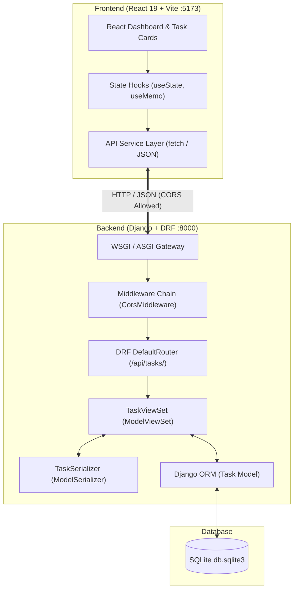

# TaskFlow - Full-Stack Task Management System

A modern, responsive, full-stack Task Management application built with **Python (Django & Django REST Framework)** on the backend and **React (Vite)** on the frontend, backed by **SQLite**.

Designed with clean architecture, RESTful standards, modular separation of concerns, and comprehensive test coverage — tailored for software engineering technical interviews.

---

## 🛠️ Tech Stack

* **Backend:** Python 3.13+, Django 6.1, Django REST Framework (DRF) 3.18, `django-cors-headers`
* **Frontend:** React 19, Vite 8, JavaScript (ES Modules, JSX)
* **Database:** SQLite (Django ORM)
* **API Architecture:** RESTful JSON APIs with optimistic UI updates and CORS configuration

---

## ✨ Features

* **Task Dashboard:** Real-time summary statistics for Total Tasks, To Do, In Progress, and Completed tasks.
* **Full CRUD Operations:** Create, view, update, and delete tasks with immediate UI synchronization.
* **Granular Field Controls:** Title, description, status (`TODO`, `IN_PROGRESS`, `DONE`), priority (`LOW`, `MEDIUM`, `HIGH`), and optional due dates.
* **Smart Overdue Indicator:** Automatically detects and flags overdue tasks that have not been completed.
* **Inline Quick-Status Updates:** Instant task status toggles via partial updates (`PATCH /api/tasks/:id/`) with optimistic UI rendering.
* **Search & Multi-Filter Toolbar:** Filter by title keyword, status, and priority simultaneously.
* **Robust Error Handling & Feedback:** Responsive modal forms, client-side validation, loading skeletons, empty-state cues, and toast notifications.

---

## 🏛️ System Architecture



---

## 🔄 Django vs. Spring Boot Reference (Interview Cheat-Sheet)

| Concept | Django / DRF | Spring Boot |
| :--- | :--- | :--- |
| **Project Setup** | `manage.py`, `settings.py` | `pom.xml`, `application.properties` |
| **Package Management** | `venv` + `requirements.txt` / `pip` | Maven (`.m2`) / Gradle |
| **Entities / Data Modeling** | `models.Model` (Active Record Pattern) | `@Entity` POJO (Data Mapper Pattern via Hibernate) |
| **Data Validation & DTOs** | `serializers.ModelSerializer` | Java Record / DTO + `@Valid` annotations |
| **Controllers / Endpoints** | `viewsets.ModelViewSet` | `@RestController` with CRUD `@RequestMapping` methods |
| **URL Dispatching** | `DefaultRouter` + `urls.py` | `DispatcherServlet` + `@GetMapping`, `@PostMapping`, etc. |
| **Middleware & Filters** | `MIDDLEWARE` list in `settings.py` | `SecurityFilterChain` & `OncePerRequestFilter` |
| **Migrations** | `makemigrations` & `migrate` | Flyway / Liquibase SQL migration scripts |

---

## 📁 Project Directory Structure

```
task-manager/
├── backend/
│   ├── config/                     # Django project configuration
│   │   ├── asgi.py
│   │   ├── settings.py             # App, middleware, CORS, and DB settings
│   │   ├── urls.py                 # Root URL configuration (/api/ inclusion)
│   │   └── wsgi.py
│   ├── tasks/                      # Domain app module
│   │   ├── migrations/             # Auto-generated database migration scripts
│   │   ├── admin.py                # Admin registration
│   │   ├── apps.py                 # App configuration
│   │   ├── models.py               # Task data model (TextChoices enum)
│   │   ├── serializers.py          # DRF TaskSerializer
│   │   ├── tests.py                # Comprehensive APITestCase test suite
│   │   ├── urls.py                 # DRF DefaultRouter routing
│   │   └── views.py                # DRF TaskViewSet
│   ├── db.sqlite3                  # Local SQLite database
│   ├── manage.py                   # Django CLI
│   └── requirements.txt            # Locked backend dependencies
│
├── frontend/
│   ├── public/                     # Static assets
│   ├── src/
│   │   ├── components/             # Modular React UI components
│   │   │   ├── DashboardStats.jsx  # Metrics cards with active filter clicks
│   │   │   ├── Navbar.jsx          # Header navigation & modal triggers
│   │   │   ├── TaskCard.jsx        # Individual card display & inline actions
│   │   │   ├── TaskForm.jsx        # Modal form for create / edit modes
│   │   │   └── TaskList.jsx        # Search/filter controls, loading & empty states
│   │   ├── services/
│   │   │   └── api.js              # Centralized backend HTTP client
│   │   ├── App.css                 # Application styling & animations
│   │   ├── App.jsx                 # Top-level state orchestration
│   │   ├── index.css               # Global baseline styles
│   │   └── main.jsx                # DOM mounting
│   ├── index.html
│   ├── package.json
│   └── vite.config.js             # Port 5173 & /api/ reverse proxy config
│
├── .gitignore                      # Python, Node, and environment ignores
└── README.md                       # Project documentation
```

---

## 🚀 Getting Started

### 1. Prerequisites
* **Python** 3.10+
* **Node.js** 18+ and **npm**

---

### 2. Backend Setup

1. **Navigate to the backend directory:**
   ```powershell
   cd backend
   ```

2. **Activate the virtual environment:**
   * On Windows:
     ```powershell
     .\venv\Scripts\activate
     ```
   * On macOS / Linux:
     ```bash
     source venv/bin/activate
     ```

3. **Install dependencies:**
   ```bash
   pip install -r requirements.txt
   ```

4. **Apply database migrations:**
   ```bash
   python manage.py migrate
   ```

5. **Start the Django development server:**
   ```bash
   python manage.py runserver 127.0.0.1:8000
   ```
   *The API will be available at `http://127.0.0.1:8000/api/tasks/`.*

---

### 3. Frontend Setup

1. **Open a new terminal and navigate to the frontend directory:**
   ```powershell
   cd frontend
   ```

2. **Install frontend dependencies:**
   ```bash
   npm install
   ```

3. **Start the Vite development server:**
   ```bash
   npm run dev
   ```
   *The application will open at `http://localhost:5173`.*

---

## 📡 REST API Reference

All routes are prefixed with `/api/tasks/`.

| Method | Endpoint | Description | Payload Example |
| :--- | :--- | :--- | :--- |
| `GET` | `/api/tasks/` | Retrieve all tasks | N/A |
| `POST` | `/api/tasks/` | Create a new task | `{"title": "Write Unit Tests", "status": "TODO", "priority": "HIGH", "due_date": "2026-11-15"}` |
| `GET` | `/api/tasks/:id/` | Retrieve a single task by ID | N/A |
| `PUT` | `/api/tasks/:id/` | Full update of an existing task | Full task JSON representation |
| `PATCH` | `/api/tasks/:id/` | Partial update (e.g. status) | `{"status": "DONE"}` |
| `DELETE` | `/api/tasks/:id/` | Permanently delete a task | N/A (Returns HTTP 204) |

### Task JSON Data Schema
```json
{
  "id": 1,
  "title": "Build React UI",
  "description": "Create responsive dashboard and form components",
  "status": "IN_PROGRESS",
  "priority": "HIGH",
  "due_date": "2026-11-20",
  "created_at": "2026-11-01T20:00:00Z",
  "updated_at": "2026-11-01T20:30:00Z"
}
```

---

## 🧪 Testing

### Backend Unit & Integration Tests
Django REST Framework test suite verifies full CRUD endpoints, status codes, and input validation:
```powershell
cd backend
python manage.py test tasks
```

### Frontend Production Build
Validate JSX syntax, ES module imports, and CSS bundle generation:
```powershell
cd frontend
npm run build
```
